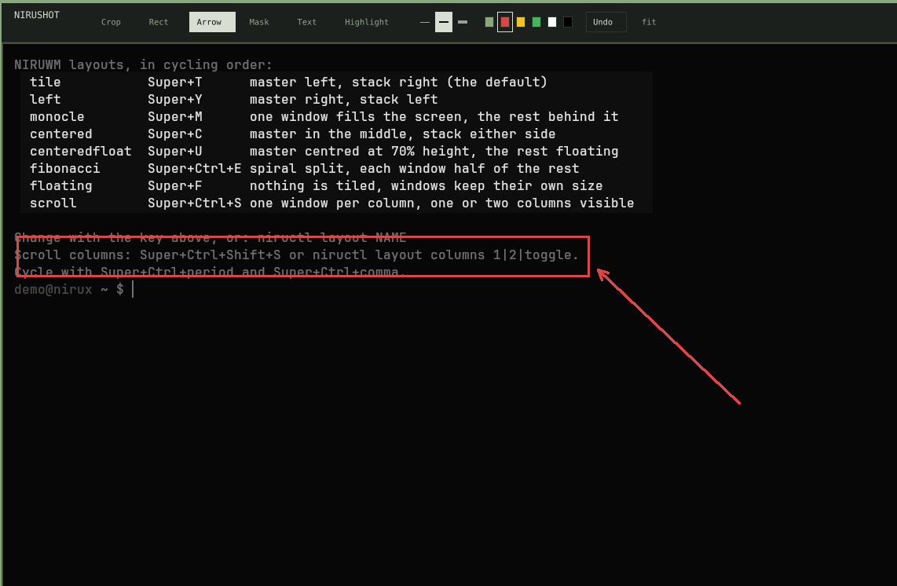

# NIRUSHOT

On-demand screenshot capture, review and annotation for the NIRUX X11 desktop.

**Status: beta** · Part of the [NIRUX](https://github.com/nirucon/nirux) suite · [MIT License](LICENSE)



## About

NIRUSHOT takes a screenshot of a region, a window or the whole screen, puts it
on the clipboard straight away and opens a small review window where you can
crop, annotate, mask and share it before saving. There is no daemon, upload
service or background process: it runs when you press the key and exits when
you are done.

## Features

- Region (`slop`), active window or full-screen capture with `maim`, with an
  optional delay.
- The original capture is **always** copied to the clipboard before review
  opens; Cancel leaves no file, but the capture stays pasteable.
- Review and annotation: crop, rectangle, arrow, opaque black mask, highlight
  (everything outside is dimmed to 50 %) and one-line text.
- Non-destructive editing: every edit is an operation over the untouched
  capture, with undo/redo (last 100 steps).
- Six colours (theme focus colour, red, yellow, green, white, black) and
  thin/medium/thick strokes; S/M/L text sizes in the theme font.
- Zoom and pan that stay smooth on large captures.
- Save, copy or share with [NIRUSHARE](https://github.com/nirucon/nirushare):
  to your own devices, or to a Discord channel through a webhook you set up
  (NIRUSHARE 0.4.0 and NIRU Launcher 0.4.0), always after a preview.
- Notification with Open, Copy and Show in folder actions after saving.
- Plays the NIRUX `screenshot` sound through NIRUNOTIFY when it runs.
- Follows the active NIRUX theme and configured monospace font; keys follow
  the active keyboard layout (Shift, AltGr, Caps Lock, Num Lock).

## Requirements

- X11 (Debian, Arch and Void glibc, x86_64).
- `maim` (capture), `slop` (region selection), `xprop` (active window),
  `xclip` (clipboard).
- Optional: `notify-send` (notifications) and `xdg-open` (notification
  actions).

NIRUX installs all of these.

## Installation

### With NIRUX

NIRUSHOT is a core component: `nirux install` and `nirux update` install and
update it as part of the pinned suite generation. The standalone installer
refuses to touch a NIRUX-managed copy; use `nirux update` instead.

### Standalone

```sh
./install.sh            # download the pinned release binary, verify SHA256SUMS, install to ~/.local/bin
./install.sh --build    # build from this checkout with cargo and install it
```

`NIRUSHOT_PREFIX` changes the prefix (default `~/.local`).

## Usage

```sh
nirushot --region                         # select a region (default)
nirushot --window                         # the active window
nirushot --full                           # all monitors
nirushot --region --delay 3               # wait three seconds first
nirushot --region --save ~/Pictures/shot.png
nirushot --full --copy                    # clipboard only, no review
nirushot --full --save shot.png --review  # save to that path from the review
nirushot --no-notify                      # no notification after saving
```

Without `--copy` or `--save` the capture opens in review. `--save PATH` writes
that file, `--copy` skips review, and `--review` opens review anyway. Saving or
copying an edited review replaces the clipboard with the edited image.

Default NIRUWM bindings:

| Key | Action |
|---|---|
| `Print` | `nirushot --region` |
| `Super+Print` | `nirushot --full` |
| `Super+Shift+Print` | `nirushot --window` |

### Review controls

| Key | Action |
|---|---|
| `c`, then drag | Crop |
| `r`, then drag | Rectangle |
| `a`, then drag | Arrow |
| `m`, then drag | Opaque black mask |
| `h`, then drag | Highlight (several highlights share one dimming; annotations are never dimmed) |
| `t`, then click | Type one line of text; `Enter` places it, `Escape` cancels it |
| `1`–`6` or the swatches | Colour for rectangles, arrows and text |
| `w` or the picker | Thin/medium/thick stroke (S/M/L size with the text tool) |
| `v` | View/pan mode; drag the image |
| Middle-drag, or hold `Space` and drag | Pan with any tool |
| Mouse wheel, `+`/`=`/`-` | Zoom |
| `0` or `f` | Fit |
| `Ctrl+Z` or Undo | Undo |
| `Ctrl+Shift+Z`, `Ctrl+Y` | Redo |
| `Delete` | Remove the last annotation (undoable) |
| `s`, `Ctrl+S` or `Enter` | Save to `~/Pictures/Screenshot-YYYY-MM-DD_HH-MM-SS.png` and copy |
| `y` or `Ctrl+C` | Copy without saving |
| `u` | Share with NIRUSHARE: opens the launcher's Share view with this screenshot (devices, and Discord webhooks with a preview first) |
| `Escape` or the close button | Discard (`Escape` first cancels a drag in progress) |

If a file with the default name already exists, `-2`, `-3` and so on are
appended.

### How editing works

The captured image is never changed. Every crop, rectangle, arrow, mask,
highlight and text is an operation in an ordered list, in the coordinates of
the image it applies to (a crop starts new coordinates for what follows). What
the window shows, and what Save, Copy and Share export, is that list drawn over
the untouched capture. Undo and redo step through earlier lists, so a wrong crop
is one `Ctrl+Z` away. The history stores operations, not image copies.

The mask is always opaque black, never a blur or pixelation, because those can
leak what is underneath.

### The review window

The region selector uses a thick, opaque amber border so it stays visible on
light and dark wallpapers. The review window is a centred floating X11 dialog,
so NIRUWM does not tile it. It opens on the monitor that holds the captured
region (or the pointer), sized for that monitor.

The window takes keyboard focus but holds **no keyboard or pointer grab**, so
the screen lock (NIRULOCK, or any X locker) can always take over while a review
is open; the review stays open underneath and keeps its edits. Only `slop`'s
short-lived region selection grabs input.

## Configuration

NIRUSHOT has no configuration file of its own. It follows the active NIRUX
theme and monospace font. The capture sound is switched in
`~/.config/nirux/sounds.toml` (`nirux sounds toggle screenshot`), and key
bindings live in the NIRUWM configuration.

## Files and paths

| Path | Purpose |
|---|---|
| `~/.local/bin/nirushot` | The program |
| `~/Pictures/Screenshot-*.png` | Default save location |
| Private temporary directory (`nirushot-*`) | The capture while it is reviewed; removed on exit |

## Troubleshooting

- **No notification actions:** the installed `notify-send` does not support
  `--action`; a plain notification is shown instead.
- **No sound:** the sound comes from NIRUNOTIFY; check that it runs and that
  `screenshot` is on in `nirux sounds status`.
- **Region selection does nothing:** check that `slop` is installed; pressing
  `Escape` in the selector cancels without a capture.

## Uninstall

With NIRUX, NIRUSHOT is removed by `nirux uninstall`. A standalone copy:

```sh
./install.sh --uninstall
```

## Building from source

```sh
cargo test --locked
cargo build --release --locked
sh tests/cli-smoke.sh target/release/nirushot
```

The smoke test uses fake capture and notification providers and needs no
graphical session. CI also runs clippy with `-D warnings`, shellcheck and an
Xvfb review test (`cargo test --release --locked --test xvfb -- --ignored`).

## Status, disclaimer and how it's made

**Status: beta.** I use it for every screenshot I take; the annotation tools
are deliberately few.

NIRUX and every niru* project are made by me, Nicklas Rudolfsson
([@nirucon](https://github.com/nirucon)), for me. They are tailored to my own
needs, preferences and workflows, on my own machines. If they fit yours too,
that's a nice bonus.

- **Free and open source.** Anyone is free to use, study, change and share
  it under the [MIT License](LICENSE).
- **No guarantees.** There is no warranty of any kind. Use it at your own
  risk, read what you install and keep backups of anything that matters.
- **How it's made.** Some of these projects I built from scratch by hand. In
  more recent releases I have used Claude, Anthropic's AI, to do much of the
  heavy lifting under my direction: I decide what to build and how it should
  behave, and I test it on my own machines. It saves me a lot of time, and
  the result is quite OK.
- **Alpha, beta, dev, and maybe forever.** Most things here are alpha, beta
  or dev, and may stay that way. Maybe one day there will be a real stable
  release, but given how fast development moves, and how I am as a person,
  maybe never :)

| Label | Meaning |
|---|---|
| dev | Under active construction; may not build, install or work yet. |
| alpha | Works on my machines, but incomplete or rough; expect breaking changes. |
| beta | In daily use on my machines and mostly complete; rough edges remain. |

## License

MIT License, see [LICENSE](LICENSE). Copyright (c) 2026 Nicklas Rudolfsson.
